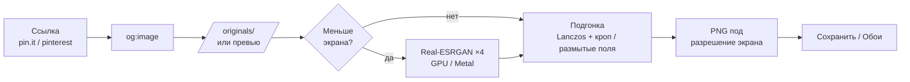

<div align="center">


# PinFit

**Ссылка с Pinterest → картинка ровно под пиксели вашего Mac, с нейросетевым апскейлом.**


[**Скачать**](../../releases/latest) · [Как это работает](#как-это-работает) · [Сборка](#сборка-из-исходников)

</div>

---

Скопировали ссылку на пин — PinFit сам её подхватит, скачает оригинал, **дорисует детали нейросетью** и отдаст PNG
в точном разрешении вашего экрана. Одной кнопкой — в обои.

Обычный ресайз растягивает мелкие картинки в мыло. PinFit увеличивает их Real-ESRGAN'ом на GPU и только потом
точно подгоняет под экран, поэтому пин в 736 px на Retina-обоях выглядит чистым, а не размазанным.

## Возможности

| | |
|---|---|
| 🔗 **Автозахват ссылки** | Скопировали `pin.it/…`, `pinterest.com/pin/…` или `i.pinimg.com/…` — приложение подхватит из буфера при запуске и при переключении на него |
| 🖼 **Оригинал, а не превью** | Вытаскивает `og:image` и пробует взять `/originals/`, если Pinterest его отдаёт |
| 📐 **Точно под ваш экран** | Разрешение берётся из системы (учитывает Retina и выбранный режим «как выглядит») |
| ✨ **Нейросетевой апскейл** | Real-ESRGAN ×4 на GPU, модели «Фото» и «Арт», всё работает офлайн |
| 🎯 **Заполнить / Вписать** | «Заполнить» обрезает под экран (кадр двигается ползунком), «Вписать» кладёт картинку на размытый фон |
| 🖥 **В обои одной кнопкой** | Или просто сохранить PNG в `~/Documents/PinFit Wallpapers` |

## Установка

1. Скачайте `PinFit.zip` со страницы [**Releases**](../../releases/latest) и распакуйте.
2. Перетащите `PinFit.app` в «Программы».
3. Первый запуск: **правый клик → «Открыть»**. Приложение подписано ad-hoc и не нотаризовано, поэтому Gatekeeper
   спросит подтверждение. Или в терминале:
   ```sh
   xattr -dr com.apple.quarantine /Applications/PinFit.app
   ```

**Требования:** macOS 13+. Рассчитано на Apple Silicon (нейросеть работает на GPU через Metal); бинарник universal.

## Как пользоваться

1. Скопируйте ссылку на пин (⌘C в приложении или браузере Pinterest).
2. Откройте PinFit: ссылка подхватится сама. Или вставьте её вручную и нажмите «Загрузить».
3. Выберите **режим** (Заполнить / Вписать) и **ИИ** (фото / арт / выкл), поправьте кадр ползунком.
4. «Сохранить» или «Поставить обоями».

> Для зернистых текстур стоит сравнить «ИИ: фото» и «ИИ: выкл»: нейросеть сглаживает мелкое зерно.

## Как это работает



- Вход нейросети заранее уменьшается так, чтобы после ×4 получить ≈1.25× от нужного размера: не тратим время на
  лишние мегапиксели, а финальное сжатие даёт запас по резкости.
- Нейросеть запускается как отдельный процесс ([Real-ESRGAN-ncnn-vulkan](https://github.com/xinntao/Real-ESRGAN-ncnn-vulkan)),
  пока она работает, сразу показывается обычный ресайз, а потом превью заменяется улучшенным.
- Приложение без зависимостей: чистый SwiftUI + ImageIO + Core Graphics + Core Image.

## Сборка из исходников

Нужны только Command Line Tools (`xcode-select --install`), Xcode не требуется.

```sh
git clone https://github.com/glob707/PinFit.git
cd PinFit
./build.sh          # соберёт dist/PinFit.app и dist/PinFit.zip
open dist/PinFit.app
```

`build.sh` сам скачает Real-ESRGAN (~52 МБ) через `scripts/fetch-realesrgan.sh` и проверит архив по SHA-256.

```
Sources/App.swift      интерфейс (SwiftUI)
Sources/Engine.swift   загрузка, апскейл, подгонка, сохранение
tools/make_icon.swift  иконка рисуется кодом
scripts/               загрузка нейросети
```

## Благодарности

- [Real-ESRGAN](https://github.com/xinntao/Real-ESRGAN) и [ncnn-vulkan](https://github.com/xinntao/Real-ESRGAN-ncnn-vulkan), Xintao Wang et al. (MIT)

## Важно

Инструмент для личного использования: картинки на Pinterest принадлежат их авторам. Используйте скачанное
в рамках правил сервиса и прав авторов.

## Лицензия

[MIT](LICENSE)
